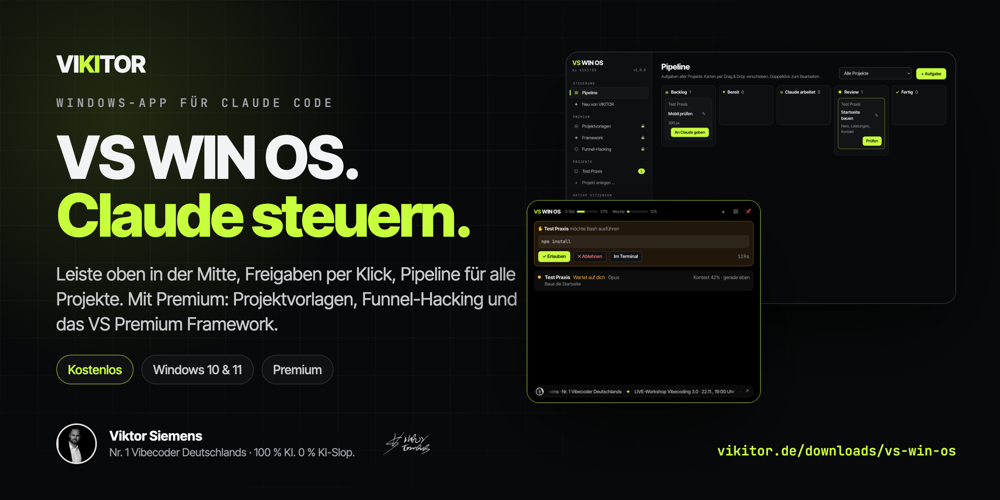

# VS WIN OS – Download

**Die kostenlose Windows-App für Claude Code von Viktor Siemens (VIKITOR).** Alle Claude-Sitzungen in einer Leiste oben in der Mitte des Bildschirms, Freigaben per Klick, eine Pipeline für alle Projekte und die Limits deines Claude-Abos immer im Blick.

**➜ [Neueste Version herunterladen](https://github.com/revolutos/vs-win-os-download/releases/latest)** · [Infos und Anleitung auf vikitor.de](https://vikitor.de/downloads/vs-win-os/)

Dieses Repository enthält nur die fertigen Programmdateien. Welche Datei du brauchst:

| Datei | Für |
|---|---|
| `VS-WIN-OS-Setup-v…-x64.exe` | Die meisten Windows-PCs und Laptops (Intel, AMD), mit Installation |
| `VS-WIN-OS-Setup-v…-arm64.exe` | Laptops mit Snapdragon-Prozessor (Windows on ARM) |
| `VS-WIN-OS-v…-x64.zip` / `-arm64.zip` | Ohne Installation: entpacken, `VS WIN OS.exe` starten |

Windows 10 oder 11. Voraussetzung ist [Claude Code](https://claude.com/claude-code). Solange die App nicht signiert ist, kann Windows SmartScreen beim ersten Start warnen: „Weitere Informationen“ → „Trotzdem ausführen“.

**Premium** (Projektvorlagen, Funnel-Hacking, VS Premium Vibecoding Framework) wird mit einem Freischaltcode aktiviert, der auch für VS MAC OS und das Browser-Addon gilt: [vikitor.de/shop](https://vikitor.de/shop/)

---

**Viktor Siemens** · Nr. 1 Vibecoder Deutschlands · KI-Experte für Premium-Webseiten & Funnels · **100 % KI. 0 % KI-Slop.**
[vikitor.de](https://vikitor.de) · [Kostenloses Live-Webinar Vibecoding 3.0](https://vikitor.de/#platz) · [Instagram](https://www.instagram.com/viktorsiemens.business/) · [LinkedIn](https://www.linkedin.com/in/viktor-siemens/)

 

© REVOLUTOS LTD · VS WIN OS by VIKITOR. Kostenlos nutzbar, Weitergabe und Weiterverkauf nicht gestattet.
